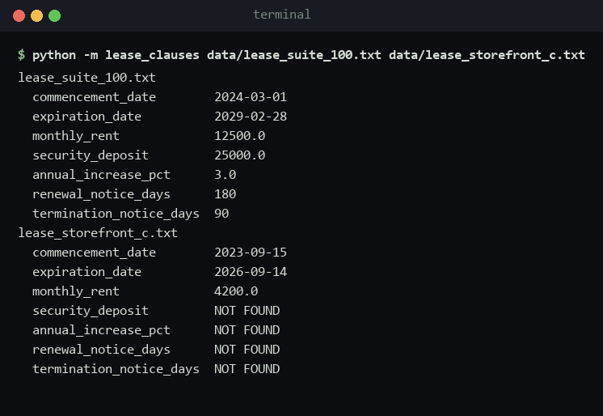

<p align="center"></p>

# lease-clause-extractor

A lease is a long document, but the few terms a property team needs every month are a handful of dates, amounts and notice periods. This repo reads plain text lease files and pulls out the commencement and expiration dates, monthly rent, security deposit, annual increase and notice periods using regular expressions, and says plainly when a term is not found.



## What it is for

Property managers and lease administrators re-type the same terms from lease after lease into a register. This tool does the first pass: it reads the text, fills in what it can recognize, shows the sentence each value came from so it can be checked in seconds, and marks the rest NOT FOUND. It is a helper for a human reviewer, not a replacement for one.

## Install

```
git clone https://github.com/yassine2med/lease-clause-extractor
cd lease-clause-extractor && pip install -r requirements.txt
```

## How to use

| I want to | Command |
|---|---|
| Extract the terms from one or more lease files | `PYTHONPATH=src python -m lease_clauses data/lease_suite_100.txt data/lease_warehouse_b.txt data/lease_storefront_c.txt` |
| Show the sentence each value came from | `PYTHONPATH=src python -m lease_clauses data/lease_suite_100.txt --show-source` |
| Print JSON instead of a table | `PYTHONPATH=src python -m lease_clauses data/lease_suite_100.txt --json` |
| Also write one CSV row per lease | `PYTHONPATH=src python -m lease_clauses data/lease_suite_100.txt data/lease_warehouse_b.txt data/lease_storefront_c.txt --csv leases.csv` |
| Show help | `PYTHONPATH=src python -m lease_clauses --help` |

Exit codes: 0 on success, 1 when a file cannot be read. Input files must be UTF-8 text.

Example:

```
PYTHONPATH=src python -m lease_clauses data/lease_warehouse_b.txt data/lease_storefront_c.txt
```

Output:

```
lease_warehouse_b.txt
  commencement_date        2025-07-01
  expiration_date          2028-06-30
  monthly_rent             16500.0
  security_deposit         33000.0
  annual_increase_pct      2.5
  renewal_notice_days      NOT FOUND
  termination_notice_days  60
lease_storefront_c.txt
  commencement_date        2023-09-15
  expiration_date          2026-09-14
  monthly_rent             4200.0
  security_deposit         NOT FOUND
  annual_increase_pct      NOT FOUND
  renewal_notice_days      NOT FOUND
  termination_notice_days  NOT FOUND
```

Run the tests with `python -m pytest -q`.

## How it works

1. The text is split into sentences on full stops followed by a capital letter, and on semicolons.
2. Each sentence is tested against keyword patterns, such as commence, expire, security deposit, rent, increase, renew and terminate.
3. Dates are read in three forms: March 1, 2026, 3/1/2026 and 2026-03-01, and stored as YYYY-MM-DD.
4. Dollar amounts are read with or without cents. Rent stated per year is divided by 12 to give monthly rent.
5. Notice periods accept digits or words such as sixty (60) days. The first sentence that matches a field wins.

## Limits

- Plain text only. Scanned PDFs and Word files must be converted first.
- English wording and US date and dollar formats only.
- Pattern matching, not understanding: unusual phrasing is reported as NOT FOUND, and an odd sentence can give a wrong value. Check each value against its source line.
- Sentence splitting is simple, so a source line can include the start of the next numbered clause.
- Only the seven fields shown are extracted, and only the first match for each.

## License

MIT. Yassine Emhamed, 2026.
